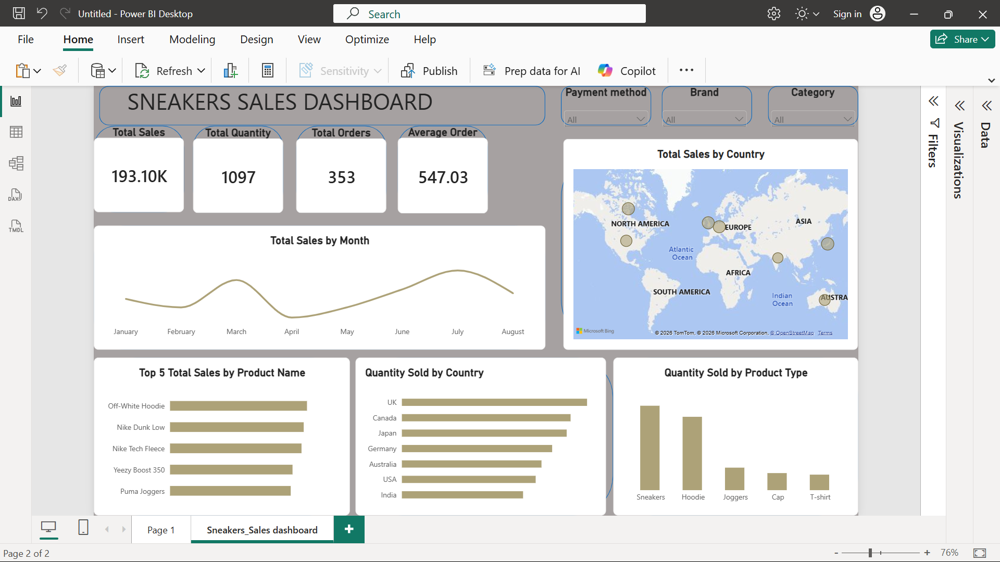

# Sneakers_Sales_AkherePaul
This project is a sales analysis of a sneakers products and these products are sold across 7 countries using Excel, Sql and PowerBI. This Project is also part of my data analysis portfolio

## Business Quesion Answered
- Which payment mode is mostly used
- Country with the highest Sales
- Country with the highest Quantity Sold
- Which brand is high in demand

## KPI
- Total Sales
- Total Quantity Sold
- Total Orders
- Average Order
## Tool Used
- Excel
- Sql
- PowerBI
## Dashboard Preview

## Key Insight
Firstly before i started working on the data i had to clean it. The data was not properly written, there was extra space within and the date was not in it correct format which could lead to error and inaccuracy of the data. The data is from January to August and it has 353 transactions orders with no duplicate. Uk had the highest quantity sold (191) but generated 29,739.25 while Japan Sold (170) quantity and generated the highest Revenue 31,587.39. Nike sold well across each countries and it is in demand in Japan. Users prefered wallet and card payment to other means of payment
## Files in Repository
[Raw data](Raw_Sneakers_Dataset.csv)
[Excel](Sneakers_DatasetOG.csv)
[Presentation](Sneakers_Sales_Presentation.pdf)
[SQL](Sneakers_Sales.sql)
[PowerBI](Sneakers_Sales_powerBI.pbix)
## Conclusion
- Keep the best sellers, Off-White Hoodie and Nike Dunk Low, well stocked.
- Investigate the April dip and plan promotions for slow months.
- Back the strongest markets (UK, Canada, Japan) and test growth in India

